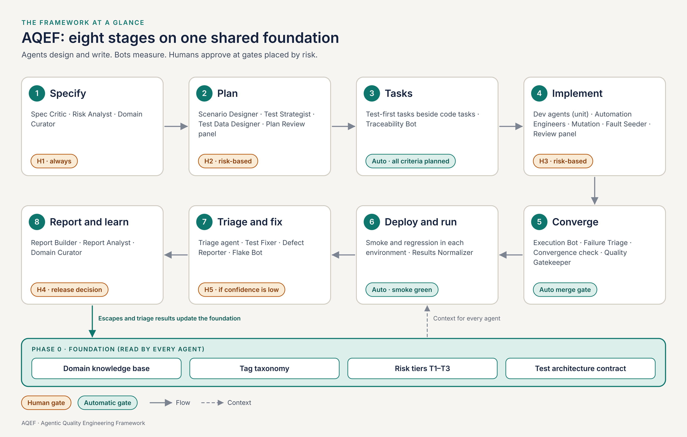

# AQEF: Agentic Quality Engineering Framework

AI agents now write code fast and cheaply, so verification is the new bottleneck.
AQEF makes verification an engineered, measured process. It uses specialist LLM agents for judgement, deterministic bots for facts, and human gates that depend on risk.



## What AQEF does

1. **The spec is the oracle.** Agents derive tests from acceptance criteria and domain rules. Test design agents do not read the implementation.
2. **Right test, right level.** Each scenario goes to the lowest test level that can prove it. Mutation testing and seeded faults measure how strong the tests are.
3. **Shared domain knowledge.** A small markdown knowledge base gives agents the correct business rules through progressive disclosure.
4. **Every failure gets a state.** Failure triage gives each failure a state, an action and a confidence value. Agents act alone only above a confidence bar.
5. **Reports by layer and by capability.** Tags connect specs, tests, results and defects, so managers see where the risk is.

AQEF is tool-agnostic. It plugs into any spec-driven AI SDLC (GitHub Spec Kit, Amazon Kiro, BMAD and similar) and any coding agent that reads markdown instructions (Claude Code, Codex, Cursor, Copilot).
**No AI API keys or tokens are needed.** Agents run inside the coding agent your team already uses, on its normal plan. CI runs only deterministic bots, with no LLM calls ([AQEF-001](docs/decisions/AQEF-001-session-first.md)).
[qestack](https://github.com/quark-sri/qestack) is one reference implementation of the test review panel and the proof and hardening gates.

## Status (v0.4.0)

| Part | Status |
| --- | --- |
| Framework doc, principles, gates, triage model | Stable enough to pilot |
| Agent and skill definitions | Draft: tested on the refund example only |
| Quality Gatekeeper (`bots/gatekeeper.py`) | Working sample, tested |
| Test Guard (`bots/testguard.py`) | Working sample, tested |
| Results Normalizer, Traceability Bot, Report Builder, Data Guard | Contracts only (see [`ROADMAP.md`](ROADMAP.md)) |
| Thresholds (mutation, seeded faults, confidence bars) | **Provisional.** Not calibrated on pilot data yet |
| AI-product testing (evals, model and prompt regression, AI safety) | Planned for milestone v0.5, narrow first version ([AQEF-003](docs/decisions/AQEF-003-ai-product-track.md)) |
| Coding agents | `AGENTS.md` entry point for any agent; agents and skills in Claude Code format |

## Repository layout

| Path | Contents |
| --- | --- |
| [`docs/core.md`](docs/core.md) | **Start here.** AQEF Core: the minimum, maturity levels, week 1 |
| [`docs/adopting.md`](docs/adopting.md) | Adopting AQEF: small teams, existing codebases, no formal specs |
| [`docs/AQEF.md`](docs/AQEF.md) | The framework: principles, phases, agents, trust model, triage, reporting, adoption |
| [`docs/decisions/`](docs/decisions/) | Framework decisions (`AQEF-nnn`): one home per rule; other files cite the ID |
| [`docs/diagrams/`](docs/diagrams/) | 15 diagrams (SVG and PNG): overview, each phase, roles, pyramid, KB, traceability, trust |
| [`examples/spec-142/`](examples/spec-142/) | Worked example: one T1 feature through every phase, with real evidence. Runs in CI |
| [`aqef-kit/`](aqef-kit/) | Starter kit: agents, skills, config, templates, gate checklists, tag taxonomy, KB example, schemas, gatekeeper and Test Guard bots |
| [`scripts/check_kit.py`](scripts/check_kit.py) | Consistency check for the kit (agent permissions, config schema, KB links, schemas and examples) |
| [`tests/`](tests/) | Tests for the gatekeeper, the Test Guard and the kit check |
| [`ROADMAP.md`](ROADMAP.md) | Known gaps and next steps |
| [`CHANGELOG.md`](CHANGELOG.md), [`CONTRIBUTING.md`](CONTRIBUTING.md) | Release history; how to propose changes |
| [`AGENTS.md`](AGENTS.md) | Instructions for coding agents working in this repo |

## Quick start

```bash
TARGET=/path/to/your-repo

# 1. Copy the kit folders into the root of your project (your README is not touched)
cd aqef-kit
cp -R .aqef domain qa taxonomy templates gates schemas bots "$TARGET"/

# 2. Claude Code: install the agents and skills
mkdir -p "$TARGET"/.claude/agents "$TARGET"/.claude/skills
find agents -name '*.md' ! -name README.md -exec cp {} "$TARGET"/.claude/agents/ \;
cp -R skills/* "$TARGET"/.claude/skills/

# 3. Agent instructions: add the AQEF section to AGENTS.md (Codex, Cursor, Copilot and others read it)
# Safe to run again: the section is added only once, and existing content is kept
touch "$TARGET"/AGENTS.md "$TARGET"/CLAUDE.md
grep -qxF '# Quality engineering (AQEF)' "$TARGET"/AGENTS.md || { echo; cat AGENTS.md; } >> "$TARGET"/AGENTS.md
# Claude Code reads CLAUDE.md: make it import AGENTS.md
grep -qxF '@AGENTS.md' "$TARGET"/CLAUDE.md || printf '\n@AGENTS.md\n' >> "$TARGET"/CLAUDE.md
```

Other coding agents: also copy `agents/` and `skills/` into the root of your project. `AGENTS.md` tells the agent where to find them.

Then edit `.aqef/config.yaml`, fill `qa/test-architecture.md` for your stack, and replace the refund example in `domain/` with your own top 5 capabilities.
See [`aqef-kit/README.md`](aqef-kit/README.md) for the phase mapping to Spec Kit, Kiro and BMAD.

Try the bots:

```bash
pip install -r aqef-kit/bots/requirements.txt
cd aqef-kit
python bots/gatekeeper.py --metrics bots/example-metrics.json   # PASS, exit 0
python bots/testguard.py --base main                           # run inside any git repo
```

The gatekeeper blocks a merge only on facts: a confirmed defect, a weakened test, a missing metric, missing red-before-green evidence or low criteria coverage. Other findings become a follow-up task (T2) or a comment (T3), so QE keeps pace with the coding agents. T1 work always waits for a human.

## Development

```bash
pip install -r requirements-dev.txt
python scripts/check_kit.py
pytest -q
```

CI runs the same checks on every push and pull request.

## Diagrams

| | |
| --- | --- |
| [Traditional vs AI era](docs/diagrams/png/02-traditional-vs-ai-era.png) | [Swimlane roles](docs/diagrams/png/03-swimlane-roles.png) |
| [Operating model](docs/diagrams/png/04-operating-model.png) | [Phase 1: Specify](docs/diagrams/png/05-stage1-specify.png) |
| [Phase 2: Plan](docs/diagrams/png/06-stage2-plan.png) | [Test level pyramid](docs/diagrams/png/07-test-level-pyramid.png) |
| [Phases 3–4: Implement](docs/diagrams/png/08-stage3-4-implement.png) | [Phase 4: Harden and review](docs/diagrams/png/09-stage4-harden-review.png) |
| [Phase 5: Converge](docs/diagrams/png/10-stage5-converge.png) | [Phases 6–7: Triage](docs/diagrams/png/11-stage6-7-triage.png) |
| [Phase 8: Reporting](docs/diagrams/png/12-stage8-reporting.png) | [Domain knowledge base](docs/diagrams/png/13-domain-knowledge-base.png) |
| [Traceability chain](docs/diagrams/png/14-traceability-chain.png) | [Trust and human gates](docs/diagrams/png/15-trust-and-human-gates.png) |

## License

[Apache-2.0](LICENSE)
