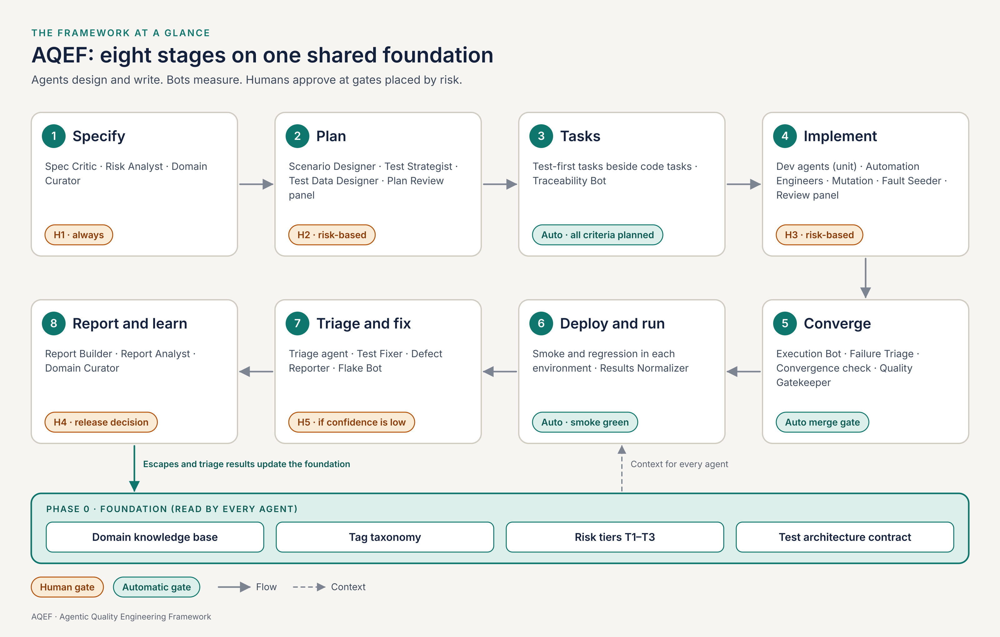

# Agentic Quality Engineering Framework (AQEF)

Nov 22, 2026 · @Srinivas

## Summary

AQEF is a quality engineering framework for teams that build software with AI agents. Agents now write code fast and cheap. Verification is the new bottleneck. AQEF makes verification an engineered, measured process. It uses specialist agents, deterministic bots and risk-based human gates.

The 2025 DORA report found that 90% of developers use AI. It also found that AI adoption still correlates with more instability: more change failures and more rework ([DORA 2025](https://research.google/pubs/dora-2025-state-of-ai-assisted-software-development-report/), [Splunk review](https://www.splunk.com/en_us/blog/learn/state-of-devops)). Testing, review and QA cannot keep pace with the new speed. AQEF closes that gap.

AQEF does five things:

1. It derives tests from the specification, not from the code. Agents that design tests do not read the implementation.
2. It puts each test at the correct level of the test pyramid, and it measures the test strength with mutation and seeded faults.
3. It gives agents a domain knowledge base in simple markdown files, so they use the correct business rules.
4. It triages every failure after deployment into a known state, and it takes the correct action for each state.
5. It reports results by test layer and by business capability, so managers see where the risk is.

AQEF is tool-agnostic. It plugs into any AI SDLC that has phases like specify, plan, tasks, implement and converge (for example GitHub Spec Kit, Amazon Kiro or BMAD). [qestack](https://github.com/quark-sri/qestack) is one reference implementation for the test review panel and quality gates. A starter kit of agent, skill and template files comes with this doc, in the [`aqef-kit/`](../aqef-kit/) folder of this repo.

AQEF runs from the team's own coding-agent sessions and needs no AI API keys or tokens. It is for teams that work with coding agents such as Claude Code, Codex, Cursor or Copilot on their normal plans. See [Where agents and bots run](#where-agents-and-bots-run) and decision [AQEF-001](decisions/AQEF-001-session-first.md).

## Core principles

Twelve principles control every decision in AQEF. When a process step is not clear, use these principles to decide.

| # | Principle | What it means in practice |
| --- | --- | --- |
| P1 | The spec is the oracle | Tests come from acceptance criteria and domain rules. Test design agents must not read the implementation. |
| P2 | No agent grades its own work | The agent that writes a test is never the agent that reviews it. Designer, writer and judge are separate agents with separate context. |
| P3 | Evidence over opinion | Every gate produces measured evidence: traceability, red-before-green, mutation score, seeded-fault detection, flakiness rate. |
| P4 | Agents for judgement, bots for facts | LLM agents design, review and classify. Deterministic scripts run tests, compute coverage and enforce gate thresholds. |
| P5 | Right test, right level | Each scenario gets the lowest test level that can prove it. The UI layer holds only critical user journeys. |
| P6 | Domain knowledge is shared and versioned | Business rules live in one markdown knowledge base. Agents load only the parts they need. |
| P7 | Everything is traceable by tags | Each test carries capability, requirement, level, risk and defect tags. Reports and triage use these tags. |
| P8 | Tests are protected | Agents must not delete, skip or weaken a test to get a green build. A guard checks every change to tests. |
| P9 | Execution is hermetic | Tests run in a dev container or ephemeral environment with seeded data, fixed clocks and no shared state. |
| P10 | Humans own intent and risk | Humans approve requirements, high-risk test plans and releases. Agents produce volume. |
| P11 | Trust is earned and measured | Each agent starts with low autonomy. It gets more autonomy only when its measured accuracy meets a threshold. |
| P12 | Every escape teaches the system | Each escaped defect and each triage result updates the knowledge base, the tests or the agent instructions. |

## Framework at a glance

AQEF adds quality activities to each phase of the AI SDLC. Agents do the design and writing work. Bots measure. Humans approve at gates that depend on risk.



More diagrams (one per phase, roles, trust model, traceability) are in [`diagrams/`](diagrams/).

The flow runs from Specify to Report. The foundation layer (knowledge base, tags, tiers, test architecture) is read by every agent. Escaped defects and triage results go back into the foundation.

## Phase 0: Foundation (once per project)

Set up four assets before the first feature. All agents depend on them. Update them continuously.

### F1. Domain knowledge base (markdown ontology)

The knowledge base (KB) is a set of small markdown files in the repo, under `domain/`. It works like an ontology: each file is one concept, and links show the relations. Agents use progressive disclosure. They read the index first, then only the files that the current story needs. This keeps the context small and correct.

```markdown
domain/
  INDEX.md                 # map of capabilities and entry points (< 150 lines)
  glossary.md              # one line per business term
  capabilities/<cap>.md    # what the capability does, its entities, rules, flows
  entities/<entity>.md     # attributes, valid values, states, invariants, relations
  rules/<rule-id>.md       # one business rule, with examples and boundary values
  workflows/<flow>.md      # state machines and step sequences
  roles.md                 # personas and permissions
  integrations/<system>.md # contracts with external systems
  risks/defect-patterns.md # known failure patterns and past escapes
```

Each file has front matter: `id`, `type`, `relates_to`, `owner`, `last_reviewed`, `source` (spec or defect ID). A Domain Curator agent proposes updates from new specs, triage results and escaped defects. A named domain expert approves each update in a pull request. The KB is the oracle for test design and for synthetic test data.

### F2. Tag taxonomy

Tags connect specs, tests, results and defects. Gherkin tags flow into the automation code as annotations. Use the same tags at every level.

| Tag | Example | Use |
| --- | --- | --- |
| `@cap:` | `@cap:payments.refund` | Capability report and heat map |
| `@req:` | `@req:SPEC-142-AC3` | Traceability to acceptance criteria |
| `@level:` | `@level:api` | Layer report and pyramid check |
| `@risk:` | `@risk:t1` | Gate rules and run order |
| `@suite:` | `@suite:smoke`, `@suite:regression` | Execution selection |
| `@defect:` | `@defect:BUG-881` | Defect verification and delta report |
| `@nfr:` | `@nfr:security`, `@nfr:a11y`, `@nfr:perf` | Non-functional report |
| `@quarantine` | `@quarantine:FLAKY-12` | Flaky tests out of the gating run |

### F3. Risk tiers

Each capability gets a risk tier. The tier controls the depth of testing and the human gates.

| Tier | Typical scope | Test depth | Human gates |
| --- | --- | --- | --- |
| T1 critical | Money, safety, security, privacy, legal | Full: mutation ≥ 80%, seeded faults ≥ 95%, NFR tests | All gates, always |
| T2 important | Core user journeys | Standard: mutation ≥ 70%, seeded faults ≥ 90% | Spec and release gates; H3 as a non-blocking follow-up on escalation |
| T3 low | Internal tools, cosmetic changes | Lite: traceability and red-before-green | Spec and release gates; escalations are comments; 10% sample audit as a follow-up |

These thresholds are **provisional starting values**. No pilot data backs them yet. Measure your own baseline in the first month, then tune them in `.aqef/config.yaml`.

### F4. Test architecture contract

Write one file, `qa/test-architecture.md`, that agents must follow. It names the frameworks per level, the folder layout, the page-object or screen pattern, the API client, fixtures, data builders, naming rules and the CI stages. The Automation Engineer agent reads it before it writes code. The review panel checks code against it.

## Phase-by-phase process

Each phase lists its quality activities, the agents, the outputs and the exit gate. Phase names are generic. Map them to your SDLC tool.

### Phase 1: Specify — make requirements testable

1. The **Spec Critic** agent reads the spec and the KB. It finds ambiguity, missing acceptance criteria, conflicts with domain rules, and untestable statements (for example "fast" or "user friendly").
2. It asks clarifying questions. It proposes measurable acceptance criteria with an ID each (`SPEC-142-AC1`).
3. The **Risk Analyst** agent assigns a risk tier and lists the main product risks for the story.
4. The **Domain Curator** agent lists new terms or rules that the KB does not have yet.

**Output:** `spec-review.md`, risk tier, KB change proposal. **Exit gate H1 (human, always):** the product owner and QE lead approve the acceptance criteria and the risk tier.

### Phase 2: Plan — design the tests

1. The **Scenario Designer** agent writes Gherkin scenarios for every acceptance criterion. It uses test design techniques: equivalence partitions, boundary values, decision tables (as `Scenario Outline` examples), state transitions, and negative and error paths. It does not read code.
2. The **Test Strategist** agent assigns a recommended level to each scenario (unit, component, contract, integration, API, UI end-to-end) and an owner (dev agent for unit, QE agent for the rest). It checks the pyramid shape and the run cost. It also tags NFR needs.
3. The **Test Data Designer** agent defines the data for each scenario from KB entities and rules: valid sets, boundary sets, invalid sets, and data builders to create.
4. The **Test Plan Reviewer** panel checks the plan: coverage of each criterion, missing negative cases, wrong expected results against the KB, wrong level, duplicates.

**Output:** `features/*.feature` with tags, `test-plan.md` with a level matrix, `test-data-plan.md`. **Exit gate H2 (human, risk-based):** T1 always; T2 when the panel says ESCALATE; T3 on a 10% sample.

### Phase 3: Tasks — put tests in the work plan

1. Test tasks go into the task list next to the code tasks. Each code task links to its scenarios.
2. Order is test-first: the test task comes before or with the code task.
3. The **Traceability Bot** creates the first traceability matrix: criterion → scenario → planned test → level.

**Exit gate:** automatic. Every acceptance criterion has at least one planned scenario.

### Phase 4: Implement — write and prove the tests

1. **Dev coding agents** write unit tests with the code (TDD). Unit tests must map to scenarios tagged `@level:unit`.
2. The **Automation Engineer** agents write integration, API and UI tests from the Gherkin. They follow `qa/test-architecture.md`. They must not change production code or weaken a test.
3. **Red-before-green:** each new test must fail on the old code or on a seeded fault, then pass on the new code. A test that never fails proves nothing.
4. The **Execution Bot** runs the new tests in the dev container.
5. The **Coverage and Traceability Analyst** compares the plan with the real tests and with code coverage. It lists gaps. The Automation Engineer adds the missing tests. This loop repeats until no gap is left or a human accepts the gap.
6. The **Test Review Panel** (for example the qestack personas) reviews the tests: shortcuts to green, hallucinated APIs, wrong oracles, flakiness, pyramid fit, maintainability, cost.
7. **Hardening:** the Mutation Bot and the Fault Seeder check that the tests catch real faults. The Flake Bot reruns the new tests (for example 10 times) to find non-determinism.

**Output:** test code, `quality-report.md` with an ACCEPT or ESCALATE result. **Exit gate H3 (human, risk-based):** a QE engineer reviews the panel report. T1: always, before merge. T2: on escalation, as a follow-up after merge. T3: on a 10% sample, as a follow-up.

### Phase 5: Converge — prove the whole change

1. The **Execution Bot** runs the full affected regression in the dev container (test impact analysis selects the set; T1 runs everything).
2. The **Failure Triage** agent classifies each failure (see the triage section). Real product defects block the merge.
3. The **Convergence Checker** confirms that spec, code and tests agree: each criterion is implemented, tested and green.
4. The **Test Guard** bot checks the diff. It fails the build when a test is deleted, skipped, retried or loses assertions without an approved waiver.
5. The **Quality Gatekeeper** bot applies the thresholds from the config and posts the PR quality summary.

**Exit gate:** automatic merge gate. Humans review only what the gatekeeper flags.

#### Blocking budget: only facts block

Decision [AQEF-002](decisions/AQEF-002-blocking-budget.md). QE must keep pace with coding agents. The gatekeeper therefore blocks a merge only on facts:

| Blocks the merge (FAIL) | Escalation (routed by tier) |
| --- | --- |
| New product defect confirmed by triage | Mutation or seeded-fault score below the tier minimum |
| Test Guard violation | UI share or flake rate above the limit |
| Secrets or real personal data in tests | NFR result missing or failed |
| Red-before-green evidence missing | Review panel ESCALATE or low test quality score |
| Acceptance criteria coverage below the tier minimum | Waived Test Guard violations |
| A required metric is missing (a bot did not report) | |

Each tier's `on_escalate` setting routes escalations: `block` (T1: the merge waits for a human), `follow_up` (T2: merge, and CI opens a follow-up task for H3) or `comment` (T3: a comment only). A missing required metric is a FAIL, never a PASS, so a broken bot cannot let bugs through.

### Phase 6: Deploy and run

1. After each deployment, CI runs smoke, then the regression suite for that environment.
2. The **Results Normalizer** bot converts all results (JUnit XML, Allure, Playwright, k6, ZAP, axe) into one schema with tags.
3. CI publishes the normalized results and the failure list as build artifacts. A person on the triage rota runs the `aqef-triage` skill in their coding agent on those results (next sections).

### Phase 7: Triage and fix

The triage agent gives each failure a state and an action. High-confidence actions run alone. The rest go to a human queue. See the triage section.

### Phase 8: Report and learn

1. The **Report Analyst** agent builds the layer report and the capability report, and it writes a short narrative of new failures, fixes and risks.
2. **Exit gate H4 (human, always):** the release owner approves the release from the report.
3. The **Domain Curator** and the **Retro** step feed escapes and triage patterns back into the KB, the tests and the agent instructions.

## Agent and bot catalogue

AQEF uses two kinds of workers. **Agents** are LLM workers for judgement. **Bots** are deterministic scripts for facts. Never use an agent for a job that a script can do exactly. Each agent has a narrow role, a fixed input, a fixed output file and "must not" rules. The starter kit has one definition file per agent.

### LLM agents

| Agent | Phase | Reads | Writes | Must not | Start autonomy |
| --- | --- | --- | --- | --- | --- |
| Spec Critic | 1 | Spec, KB | `spec-review.md` | Change the spec | L1 draft |
| Risk Analyst | 1 | Spec, KB risks, defect history | Risk tier, risk list | Lower a T1 tier | L1 draft |
| Domain Curator | 0, 1, 8 | Specs, defects, triage records | KB change PR | Merge KB changes | L1 draft |
| Scenario Designer | 2 | Spec, KB | `.feature` files | Read implementation code | L2 act, reviewed |
| Test Strategist | 2 | Features, test architecture | Level matrix in `test-plan.md` | Put a scenario on UI when a lower level can prove it, without a reason | L2 |
| Test Data Designer | 2 | Features, KB entities and rules | `test-data-plan.md`, builder specs | Use production personal data | L2 |
| Test Plan Reviewer (panel) | 2 | Plan, KB | Plan review findings | Edit files | L3 report |
| Automation Engineer (per layer) | 4 | Features, test architecture, public interfaces | Test code | Change production code; skip, delete or weaken tests | L2 |
| Test Review Panel (personas) | 4 | Test code, plan, KB | `quality-report.md` with ACCEPT or ESCALATE | Edit files | L3 report |
| Fault Seeder | 4 | Code, KB defect patterns | Hidden fault patches | Tell the writer about the faults | L3 |
| Coverage and Traceability Analyst | 4, 5 | Matrix, coverage data, results | Gap list | Close a gap by deleting a requirement | L3 |
| Failure Triage | 5, 7 | Normalized results, logs, history, recent commits | Triage record per failure | Close a T1 failure as flaky alone | L1 then L3 by state |
| Test Fixer | 7 | Triage record, test code | Fix PR for test defects | Change assertions on expected business values without approval | L2 |
| Defect Reporter | 7 | Triage record | Defect ticket draft | Raise duplicates (must search first) | L2 |
| Report Analyst | 8 | Normalized results, tags, defects | Report narrative | Hide or round away failures | L3 |
| NFR agents (security, performance, accessibility) | 2, 4 | Spec, NFR budgets | NFR scenarios and scripts | Lower a budget | L2 |

### Deterministic bots

| Bot | Job |
| --- | --- |
| Execution Bot | Runs suites in dev container or CI by tags; collects artifacts (logs, screenshots, traces, video) |
| Results Normalizer | Converts every result format into one JSON schema with tags |
| Traceability Bot | Builds the matrix from tags: criterion → scenario → test → last result |
| Mutation Bot | Runs mutation testing (for example PIT, Stryker, mutmut) on changed code |
| Flake Bot | Reruns tests, computes flake rate, manages the quarantine list |
| Test Guard | Blocks diffs that delete, skip or weaken tests without an approved reason (sample in the kit: `bots/testguard.py`) |
| Quality Gatekeeper | Reads `.aqef/config.yaml`, compares metrics with thresholds, sets PASS, FOLLOW_UP, FAIL or ESCALATE (sample in the kit: `bots/gatekeeper.py`) |
| Report Builder | Builds the layer and capability dashboards from normalized results |

### Where agents and bots run

AQEF does not need AI API keys, tokens or a model account for CI (decision [AQEF-001](decisions/AQEF-001-session-first.md): session-first for this phase).

| Worker | Runs where | Needs |
| --- | --- | --- |
| LLM agents and skills | In the coding agent that a developer or QE engineer already uses (Claude Code, Codex, Cursor, Copilot), in their own session | The team's normal coding-agent plan |
| Deterministic bots | In CI or on a laptop | Python, test tools; no LLM |
| Human gates | Pull request reviews, issue tracker | People |

Phases that run after CI (triage, reporting) work the same way. CI produces the facts: normalized results, failure list, gatekeeper decision. A person runs the skill in their coding agent on those artifacts. Teams that already run a coding agent unattended in CI can automate these steps. The current version of AQEF does not require it, and its artifacts are plain files, so automation can be added later without changes.

### Context rules for every agent

- Load `domain/INDEX.md` first. Then load only linked files that the task needs.
- Write output to a fixed file path with a fixed template. Never answer only in chat.
- Cite evidence: file and line, scenario ID, rule ID or log line.
- Give a confidence value (0 to 1) for each decision. The gatekeeper uses it.
- Stop and escalate when the KB and the spec disagree.

## Trust model and human quality gates

You can rely on an agent when you have measured how often it is right. AQEF gives each agent an autonomy level. The level goes up only with evidence, and it goes down after a serious miss.

### Autonomy levels

| Level | Name | The agent does | The human does |
| --- | --- | --- | --- |
| L0 | Suggest | Gives ideas in a report | Does the work |
| L1 | Draft | Writes the output | Approves every output |
| L2 | Act, reviewed | Commits the output in a PR | Reviews the PR (risk-based) |
| L3 | Act alone, audited | Acts and logs evidence | Audits a sample (for example 10%) each sprint |
| L4 | Autonomous | Acts alone | Reviews monthly metrics only |

### Promotion and demotion rules

- **Promote** one level when the agent has at least 50 decisions in the last 30 days, the human audit agrees with at least 95% of them, and no T1 miss happened.
- **Demote** one level at once after one T1 miss (for example a real defect closed as flaky), or when audit agreement falls below 90%.
- **Calibrate** with known answers. The Fault Seeder plants faults. A sample of past triage records with known outcomes is replayed each month. This gives an objective accuracy for review and triage agents.
- Keep the levels per agent and per tier in `.aqef/config.yaml`. An agent can be L3 for T3 work and L1 for T1 work.
- Read-only agents (review panels, Report Analyst) can start at L3, because they only report and a human gate always reads their output. Agents that write or act start at L1 or L2.

### Human quality gates

| Gate | When | Who | Decision | Evidence given to the human |
| --- | --- | --- | --- | --- |
| H1 Requirement review | Phase 1, always | Product owner, QE lead | Acceptance criteria and risk tier approved | `spec-review.md`, risk list |
| H2 Test plan review | Phase 2; T1 always, T2 on ESCALATE, T3 10% sample | QE engineer, domain expert | Scenarios and levels approved | Feature files, level matrix, panel findings |
| H3 Test review after implementation | Phase 4; T1 always (blocks merge); T2 on escalation and T3 on a 10% sample (follow-up after merge) | QE engineer | Tests accepted | `quality-report.md`, mutation and fault scores |
| H4 Release readiness | Phase 8, always | Release owner, QE lead | Go or no-go | Layer and capability report, open defects, NFR results |
| H5 Triage confirmation | Phase 7, below the confidence bar | QE engineer on triage rota | State and action confirmed | Triage record with evidence |
| H6 Knowledge base change | Any time | Domain expert | KB PR merged | Curator diff and source |

A human gate must never ask a person to read everything. The agent report must rank findings and show evidence, so the review takes minutes, not hours.

## Failure triage flow

Every failed test gets one triage state, one action and one confidence value. The triage agent acts alone only above the confidence bar. Research shows that a rerun alone is not safe. Flaky tests can also find real defects, and a flaky failure can be wrongly ignored as noise ([Alshammari et al., 2024](https://arxiv.org/abs/2401.15788)). The same paper cites earlier work: roughly half of the flaky tests in one dataset failed persistently when rerun in isolation (Lam et al.), and ignoring all failures of flaky tests in Chromium would have missed 76% of true regression faults (Haben et al.).

### Triage steps

1. **Group.** Cluster failures by error signature, stack trace and test step. One root cause gives one record, not 40.
2. **Match.** Compare with known defects (`@defect:` tags and open tickets) and with past triage records.
3. **Check the environment.** Read health checks, deployment logs and service status. If many unrelated tests fail at the same step, suspect the environment.
4. **Rerun.** Rerun the failed tests once in a clean container. Record pass or fail.
5. **Diff.** Look at recent commits to the product code, the test code, the test data and the spec.
6. **Classify.** Give a state and a confidence value. Cite the evidence.
7. **Act** if the confidence is above the bar for that state and tier. Otherwise send to the human queue (gate H5).

### Triage states and actions

| State | Signal | Action | Acts alone when |
| --- | --- | --- | --- |
| Product defect (new) | Fails on rerun; product code changed; assertion on business value | Defect Reporter raises a bug with logs, steps and tags; test tagged `@defect:` | Confidence ≥ 0.85 and no duplicate found |
| Known defect | Matches an open defect | Link the failure to the defect; no new ticket | Confidence ≥ 0.90 |
| Regression of a fixed defect | Test tagged with a closed `@defect:` fails again | Reopen the defect; alert the owner | Always alert; reopen needs H5 for T1 |
| Test defect | Locator, wait, wrong assertion logic, outdated step; product behaviour is correct per spec | Test Fixer opens a fix PR; panel reviews it | Confidence ≥ 0.85 and no expected business value changes |
| Expected change | Spec or KB changed; the test still checks old behaviour | Update the scenario and test from the new spec | Never alone: needs H5 (it changes the oracle) |
| Test data issue | Missing, stale or shared data | Fix the data builder or reseed | Confidence ≥ 0.85 |
| Environment or infrastructure | Health check fails; many tests fail at one step; timeouts | Raise an ops ticket; rerun after recovery | Confidence ≥ 0.80 |
| Flaky | Passes on rerun with no change; history shows mixed results | Quarantine with `@quarantine:` and a ticket; set a fix deadline | T2 or T3 only; T1 needs H5 |
| Needs investigation | Confidence below the bar | Human queue with all evidence | — |

### Triage rules

- A T1 failure never leaves the gating suite without a human decision.
- Quarantined tests still run in a non-gating job. The Flake Bot tracks them. A test in quarantine for more than two sprints goes to the QE lead.
- Every triage record is saved (`triage/<run-id>/<cluster-id>.md`). These records train and calibrate the triage agent and feed the Domain Curator.

## Reporting

One normalized result store feeds every report. The Report Builder bot makes the numbers. The Report Analyst agent writes the narrative. The tags make all views possible without extra work.

### Normalized result record

Each test result has: `run_id`, `env`, `build`, `commit`, `test_id`, `title`, `level`, `capability`, `requirements[]`, `risk`, `defects[]`, `suite`, `status`, `duration_ms`, `error_signature`, `artifacts[]`, `triage_state`, `first_failed_run`. The schema is in the starter kit.

### Report views

| View | Audience | Shows |
| --- | --- | --- |
| Run summary | Everyone | Pass, fail, skip, quarantined; duration; gate result |
| Layer report | QE, developers | Results per level: unit, component, contract, integration, API, UI, NFR. Pyramid shape and run time per layer |
| Capability heat map | Managers, product owners | Pass rate and open defects per `@cap:`, coloured by risk tier. Shows which business areas have problems |
| Delta report | Release owner | **New failures** (passed last run, fail now), **fixed** (failed last run, pass now), **still failing**, **verified defect fixes** (tests tagged with a defect that now pass after a deploy) |
| Traceability report | QE lead, auditors | Each acceptance criterion → scenarios → tests → last result. Gaps in red |
| Triage report | QE lead | Failures by triage state; auto-actions taken; human queue size; time to triage |
| Test health | QE lead | Flake rate, quarantine age, mutation score trend, slowest tests |
| Agent performance | QE lead, platform team | Decisions, audit agreement, overrides and autonomy level per agent |

### Report narrative

The Report Analyst writes five short parts: release verdict, new failures and their triage, defect fixes verified, capability risks, and test health concerns. Every statement links to the run or the ticket. The narrative never replaces the numbers.

## Test data, non-functional testing and metrics

### Test data: synthetic from the domain model

1. Each KB entity file defines attributes, valid ranges, formats, states and invariants. This is the data contract.
2. Each KB rule file gives examples and boundary values. The Test Data Designer turns them into data sets: valid, boundary, invalid and state-specific.
3. The Automation Engineer writes **builders and factories** in code (for example `aCustomer().withTier(GOLD).build()`). Tests never use shared, hand-made records.
4. Generators use a fixed seed. A failed test can be replayed with the same data.
5. Each test creates and cleans its own data. Parallel runs do not collide.
6. No production personal data. A Data Guard check scans fixtures for real emails, card numbers and similar patterns.
7. A data catalogue (`qa/test-data-catalogue.md`) lists builders and named data sets, so agents reuse them.

### Non-functional testing

| Type | Plan phase | Implement and converge | Post-deploy | Gate |
| --- | --- | --- | --- | --- |
| Security | Spec Critic flags auth, input, data exposure; scenarios tagged `@nfr:security` for authorization and abuse cases | SAST, dependency scan, secret scan on each PR; API authorization tests | DAST baseline (for example OWASP ZAP) per environment | No new high or critical finding |
| Performance | Spec Critic asks for latency and throughput budgets per endpoint | Micro-benchmarks for hot paths; short load test in container | Load and soak test (for example k6, Gatling) on staging for T1 | p95 latency and error rate within budget; no regression > 10% |
| Accessibility | UI scenarios include keyboard and screen reader paths, tagged `@nfr:a11y` | Automated axe checks in UI tests | Full page scans; manual audit for T1 journeys each release | No WCAG 2.2 AA violation at serious or critical level |

Automated accessibility checks find only part of the issues. Keep a human audit for T1 journeys.

### Metrics

| Area | Metric | Starting target |
| --- | --- | --- |
| Spec quality | Acceptance criteria changed after H1 | Falls each quarter |
| Coverage | Acceptance criteria with a passing automated test | 100% for T1, ≥ 95% overall |
| Test strength | Mutation score on changed code | T1 ≥ 80%, T2 ≥ 70% |
| Test strength | Seeded faults detected | T1 ≥ 95%, T2 ≥ 90% |
| Pyramid | Share of tests at UI level | ≤ 10% of tests |
| Stability | Flake rate in gating suites | < 1% |
| Speed | QE time added to PR feedback | T2 and T3 ≤ 10 min, T1 ≤ 20 min; a target, not a gate ([AQEF-004](decisions/AQEF-004-speed-budget.md)) |
| Speed | Human gate response time | H3, H5 ≤ 4 working hours; H1, H2 ≤ 1 working day; never auto-approved ([AQEF-004](decisions/AQEF-004-speed-budget.md)) |
| Triage | Mean time to triage a failure | < 1 hour |
| Triage | Triage accuracy against human audit | ≥ 95% before L3 |
| Outcome | Escaped defects per release, by capability | Falls each quarter |
| Outcome | Change failure rate (DORA) | Falls each quarter |
| Trust | Human override rate per agent | Falls each quarter |

All targets are starting points. Set your own baseline in the first month, then improve from it.

## Adoption

### Lite path and full path

| Element | Lite path (small team, T2 and T3 work) | Full path (large or regulated programs, T1 work) |
| --- | --- | --- |
| Knowledge base | Index, glossary, top 5 capabilities | Full ontology with owners and review dates |
| Plan phase | Scenario Designer + Test Strategist; panel optional | All plan agents + Test Plan Reviewer panel |
| Implement phase | Red-before-green, traceability, Test Guard | Plus mutation, seeded faults, flake reruns, full panel |
| Human gates | H1 and H4 always; H2 and H3 as follow-ups on escalation | All gates per the tier table; audit trail stored |
| Triage | Triage agent at L1 (recommend only) | Triage agent promoted per state as accuracy grows |
| Reports | Run summary, delta, capability view | All views plus agent performance and audit export |

### Rollout plan

1. **Weeks 1–2: Foundation.** Write the test architecture contract, the tag taxonomy and the KB index. Pick one pilot capability.
2. **Weeks 3–6: Plan-phase agents.** Run Spec Critic, Scenario Designer and Test Strategist on the pilot. All agents at L1. Measure how many human edits each output needs.
3. **Weeks 7–10: Implement-phase agents.** Add the Automation Engineer, review panel, Test Guard and red-before-green proof. Add mutation for T1.
4. **Weeks 11–14: Run and triage.** Normalize results, start the triage agent at L1, build the delta and capability reports.
5. **Week 15 onward: Scale.** Add capabilities. Promote agents that meet the trust thresholds. Review metrics each sprint.

### Starter kit

The starter kit ([`aqef-kit/`](../aqef-kit/)) has: agent definitions, skills per phase, `.aqef/config.yaml` with tiers, thresholds and autonomy levels, templates (spec review, feature file, test plan, quality report, triage record, defect report, release report), human gate checklists, a domain KB skeleton with examples, a tag taxonomy and JSON schemas for results and triage records. Copy it into a repo and adapt the names to your SDLC tool.

### Sources

- [DORA 2025: State of AI-assisted Software Development](https://research.google/pubs/dora-2025-state-of-ai-assisted-software-development-report/)
- [Splunk: review of the DORA 2025 report](https://www.splunk.com/en_us/blog/learn/state-of-devops)
- [GitHub: Spec-driven development with AI (Spec Kit)](https://github.blog/ai-and-ml/github-copilot/spec-driven-development-with-ai-get-started-with-a-new-open-source-toolkit/)
- [Piskala: Spec-Driven Development, from code to contract (arXiv 2602.00180)](https://arxiv.org/html/2602.00180)
- [Meta: Mutation-guided LLM-based test generation (ACH)](https://arxiv.org/abs/2501.12862)
- [Meta engineering blog: LLM-powered bug catchers](https://engineering.fb.com/2025/02/05/security/revolutionizing-software-testing-llm-powered-bug-catchers-meta-ach/)
- [Alshammari, Ammann, Hilton, Bell: 230,439 test failures later, an empirical evaluation of flaky failure classifiers (arXiv 2401.15788)](https://arxiv.org/abs/2401.15788)
- [FlaXifyer: intermittent job failure triage (arXiv 2601.22264)](https://arxiv.org/html/2601.22264)
- [qestack: QA toolkit for AI coding agents](https://github.com/quark-sri/qestack)
